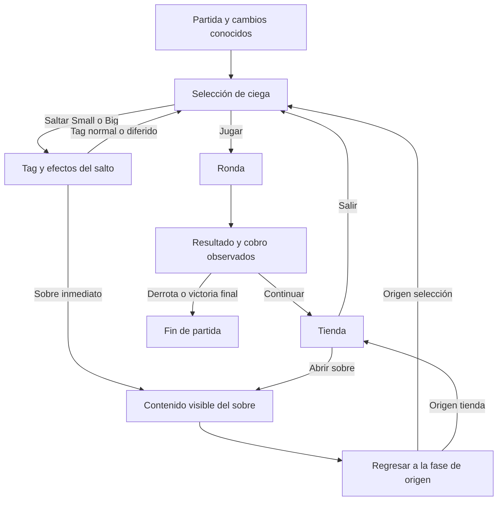

# De valorador de composición a asesor de partida

Propuesta del 15 de octubre de 2026, basada en el [informe del código](reporte-codigo-2026-10-15.md) y el [recorrido verificado de la build 1.0.1o](evidencia/ciclo-partida-1.0.1o.md). Es un plan de desarrollo, no funcionalidad ya implementada. La [hoja de ruta de ejecución](hoja-de-ruta-asesor.md) concreta entregas, contratos, dependencias y evaluación del resultado final.

Actualización del 16: [SHOP03a](tienda-persistente.md) ya conecta ofertas de comodines y acciones confirmadas al registro. Los demás pasos de este recorrido siguen como objetivo; la integración de tienda no implementa el ciclo de ciegas ni valida la eficacia estratégica.

**Objetivo:** que una persona empiece o continúe una partida, introduzca solo datos nuevos y reciba una acción contextual explicable: jugar/saltar, comprar/ahorrar/vender, elegir contenido o preparar el jefe. La web no controla Balatro ni conoce la semilla. «Mejor» debe significar la mejor opción entre las alternativas y condiciones realmente evaluadas, no una garantía de victoria.

## 1. El recorrido que el asesor necesita acompañar

La [FAQ oficial](https://www.playbalatro.com/faq) describe el orden pequeña → grande → jefe y el final tradicional en ante 8. Los detalles de eventos siguientes se contrastaron mediante inspección del ejecutable; no se jugó una nueva sesión para este informe.

| Paso real | Lo que decide el jugador | Lo que debería hacer la web |
|---|---|---|
| 1. Empezar o continuar | Baraja/dificultad o estado actual | Inicializar lo conocido; recuperar una sesión anterior; no exigir introducir de nuevo los comodines |
| 2. Selección de ciega | Jugar Small/Big o saltar por su tag; preparar el jefe visible | Comparar coste de oportunidad, recursos, crecimiento, tag y condiciones de la siguiente ciega |
| 3A. Saltar | Aceptar el tag y pasar a la siguiente ciega | Registrar solo consecuencias reales del salto; no cobrar una ronda ficticia ni abrir una tienda ordinaria |
| 3B. Jugar | Entrar en la ronda; jugar/descartar/ordenar/usar consumibles | Ofrecer ayuda de manos en modo separado y opcional; mantener ronda y recursos si se usa ese modo |
| 4. Resolver manos | Puntuar, robar y decidir otra jugada mientras haga falta | Respetar efectos por fase, cartas retenidas/puntuadas y orden; detener la ronda al alcanzar el objetivo |
| 5. Terminar la ciega | Ganar/perder o aplicar una excepción real | Registrar el resultado observado y los cambios; no copiar una simulación al registro |
| 6. Cobrar | Recibir premio, recursos sobrantes, intereses y efectos compatibles | Mostrar cálculo cuando se conoce; aceptar una corrección explícita del saldo si difiere |
| 7. Tienda | Comprar, conservar dinero, vender/reemplazar, adquirir vale o consumible | Usar una única tienda con precios observados y recalcular después de cada acción confirmada |
| 8. Abrir sobre | Elegir/usar cartas visibles, objetivos y elecciones restantes, u omitir | Comparar contenido conocido; mantener separados pagar, abrir, elegir, usar y omitir |
| 9. Salir de tienda | Pasar a selección y aplicar efectos de salida | Registrar los efectos compatibles y mantener pendientes los resultados desconocidos |
| 10. Vencer al jefe | Avanzar ante o completar el objetivo | Avanzar el progreso correcto; pedir solo el nuevo jefe, tags/ofertas y cambios que se vayan revelando |

El jefe no se salta como Small/Big. Saltar no produce el cobro de una ronda que no se jugó, pero un tag puede entregar dinero o abrir inmediatamente un sobre. Los tags diferidos conservan su momento de activación. **Red Card crece al omitir un sobre, no al saltar una ciega.** [Reglas y casos mínimos](evidencia/ciclo-partida-1.0.1o.md).

La apertura no debe tener un regreso fijo a tienda: un sobre obtenido por tag puede devolver a selección. Los consumibles también necesitan acciones legales según su contexto, no una única pantalla global.

## 2. Cómo pedir pocos datos sin inventar los demás

### Una vez al comenzar

**Partida nueva:** baraja y dificultad. Versión/plataforma/mods pueden reutilizar el perfil ya declarado para esta instalación, con posibilidad de corregirlo. La elección de baraja inicializa composición, recursos y objetos iniciales únicamente al crear una partida nueva compatible. Errática conserva desconocidas sus cartas aleatorias.

**Partida en curso:** ante/ciega actual, dinero, comodines en orden y vales; consumibles si los tiene. Preguntar si el mazo sigue siendo el inicial o cambió. Si cambió y no se transcribe, conservar composición desconocida: elegir «Amarilla» no demuestra que sus 52 cartas sigan intactas.

Las dificultades fuera de cobertura deben mostrarse como limitadas. No seleccionar White silenciosamente para que el cálculo pase.

### Datos que se pueden mantener automáticamente

- Orden Small → Big → Boss y avance de ante después de un jefe superado, a partir de eventos confirmados.
- Precio pagado, saldo posterior, inventario, huecos y efectos deterministas de una compra/venta compatible confirmada.
- Modificaciones iniciales de baraja y efectos persistentes implementados de vales adquiridos.
- Cambios al mazo que se registraron: añadir, retirar, duplicar, mejorar o cambiar una carta.
- Historial y contadores cuando los datos observados permiten actualizarlos correctamente.

«Automático» significa derivado de hechos registrados. No incluye adivinar ofertas, jefe, tag, robos, resultados aleatorios o acciones que el jugador no comunicó.

### Lo que el usuario actualiza durante la run

| Momento | Entrada mínima nueva | Lo que no debe repetir |
|---|---|---|
| Nueva selección | Tag ofrecido y jefe visible cuando todavía no se conocen | Baraja, comodines y vales sin cambios |
| Nueva tienda | Artículos y precios que ve; confirmar cambios de inventario | Todo el estado previo |
| Acción realizada | «Compré», «Vendí», «Usé» o «Salté», con el resultado desconocido que corresponda | Pulsar además un botón separado de Guardar |
| Fin de ciega sin asistencia de manos | Resultado, saldo/cobro observado y cambios relevantes; rendimiento reciente si ayuda al consejo | Todas las cartas de cada mano jugada |
| Sobre abierto | Opciones visibles y, si hace falta, cartas objetivo/elecciones restantes | El contenido de sobres anteriores |
| Cambio de mazo | Solo las cartas o cantidades afectadas | Reescribir 52 cartas |

Un resumen de manos/descartes no siempre basta para reconstruir contadores: pueden importar el orden, mínimos a cero, figuras jugadas o resultados aleatorios. En modo rápido se puede pedir **el contador final observado**, sin fabricar una secuencia de manos. Los datos que no se actualizaron conservan incertidumbre.

### Preguntas por dependencia

La API debería devolver necesidades tipadas, no solo texto «Falta…»: dato/objeto, tipo de respuesta, decisiones afectadas, motivo y evento que lo vuelve obsoleto. Empezar por el dato que impide descartar o distinguir una alternativa; no abrir un cuestionario para todo el catálogo.

| Decisión o efecto | Pregunta útil si falta el dato | Error que evita |
|---|---|---|
| Barón | ¿Cuántos reyes tiene tu mazo? ¿Qué soporte de retención existe? | Confundir Barón con un requisito de Acero: necesita reyes retenidos; Acero no es un requisito universal |
| Mimo | ¿Hay Acero/Oro/sellos azules u otro efecto retenido pertinente? | Contar cualquier carta como un beneficio o prometer que estará retenida |
| Comodín escalador | ¿Cuál es su contador actual? | Considerar que uno comprado hereda el crecimiento del vendido |
| Salto de ciega | ¿Qué tag se ofrece y qué jefe viene? | Recomendar saltar usando solo el ante |
| Descuento/venta | ¿Qué precio/valor ves? ¿Qué modificador está activo? | Validar una compra a un precio diferente del que se pagará |
| Compra urgente | ¿Qué rendimiento reciente se observó y bajo qué condiciones? | Tratar la nota editorial como prueba de superar la ciega |

El dato de rendimiento ayuda a contextualizar, pero una sola mano favorable no demuestra consistencia del mazo ni garantiza el resultado frente a otro jefe.

### Dos niveles de precisión

1. **Modo rápido:** composición parcial, historial observado y reglas estratégicas. Debe poder ayudar sin cartas exactas ni planes. Sus conclusiones siguen condicionadas por los datos disponibles.
2. **Cálculo de manos:** mano visible, cartas/modificaciones, recursos restantes, objetivo/jefe y orden. Reutiliza H2/EFHIII y permite evaluar jugar/descartar. Permanece opcional y separado.

Un resumen como «6 aceros, 5 reyes, 50 cartas» necesita un modelo parcial propio: no informa cuántos reyes también son de Acero ni qué IDs tienen. Validar límites e intersecciones conocidas; no inventar cartas para satisfacerlo ni dar ese resumen al puntuador exacto como si fuera un mazo completo.

## 3. Cómo decidir sin reducirlo todo a una nota

Mantener el puntaje y las barras como resumen compacto. **La decisión debe tener su propia comparación** y explicar el intercambio real entre puntuación disponible, dinero, preparación, crecimiento y condiciones.

Secuencia propuesta:

1. Enumerar acciones legales en la fase actual y declarar límites de búsqueda.
2. Comparar consecuencias deterministas sobre copias del mismo estado.
3. Examinar necesidades de la siguiente ciega/jefe con la evidencia disponible. Si falta el dato decisivo, preguntar o dar consejo condicional; no inventar seguridad.
4. Valorar mejora incremental y sacrificios. Otro efecto del mismo rol puede ser útil; un escalador desarrollado puede ser reemplazable si la necesidad lo justifica.
5. Entre opciones suficientes para las condiciones evaluadas, considerar reserva, ingresos, recursos y desarrollo. No sumar dólares y fichas en una unidad sin fundamento.
6. Admitir empate o alternativas sensibles a supuestos. Después de una acción real confirmada, recalcular desde el estado nuevo.

No hace falta empezar con búsqueda ilimitada: conservar, una compra, una venta→compra y secuencias legales de profundidad pequeña ya mejoran el producto. Dos compras independientes no equivalen a poder pagar y alojar ambas; cada paso usa el estado resultante del anterior. Una oferta de contenido desconocido detiene esa rama en el límite de información.

### Ejemplo de salto que el sistema actual todavía no resuelve

Caso sintético posible: Amarilla/White, ante 2/Small, $25, cuatro manos, Economy Tag, sin otros modificadores económicos. Se declara un escenario que gana en una mano; no se predice ese robo.

| Alternativa | Resultado calculable bajo las premisas | Lo que queda sin valorar |
|---|---|---|
| Jugar y vencer usando una mano | $25 + $3 premio + $3 manos sobrantes + $5 interés = **$36**, acceso a una tienda | Qué se ofrecerá, crecimiento/consumos de la ronda y robustez de ganar en una mano |
| Saltar y recoger Economy | $25 + $25 = **$50**, siguiente ciega Big, sin la tienda ordinaria de Small | Si compensa perder esa tienda y el desarrollo; supervivencia ante Big/jefe |

El asesor puede explicar que saltar conserva más dinero inmediato en este escenario y que jugar ofrece otra oportunidad de compra/desarrollo. **No puede concluir que $50 sea la mejor ruta hacia ante 8 solo porque supera $36.** Las fuentes y factibilidad del tag están en la [evidencia](evidencia/ciclo-partida-1.0.1o.md).

### Supervivencia con pocas entradas

La primera entrega puede usar condiciones y observaciones para un consejo prudente, pero eso no sustituye una estimación validada del rendimiento. Para comparar automáticamente la fuerza de construcciones después harán falta evaluaciones que el usuario no tenga que escribir:

- Casos internos reproducibles de activación, conflicto y estrés, declarados como escenarios, sin llamarlos distribuciones representativas por conveniencia.
- Cuando exista composición suficiente, generación/evaluación de manos y decisiones de descarte bajo un modelo de robos explícito. H2/EFHIII aportan puntuación; falta una política de selección y su evaluación.
- Simulación posterior reproducible y validada si se quieren distribuciones. No conocer la semilla no impide modelar incertidumbre, pero sí impide presentar robos simulados como lo que ocurrirá.

La simulación no es requisito para guardar una partida, registrar un salto o comparar costes conocidos. Tampoco puede compensar un estado inventado, reglas incompletas o una política de juego deficiente. Sin validación no mostrar porcentajes de victoria/confianza.

## 4. Entregas y dependencias reales

El [plan de ejecución](hoja-de-ruta-asesor.md#4-entregas-y-dependencias) es la referencia vigente para tareas y aceptación. Corrige dos dependencias: conectar la compra/venta visual puede comenzar con las fases actuales, y no necesita esperar a abrir sobres.

El orden de integración es **tienda persistente → recorrido de partida → consejo incremental → jugar/saltar y elecciones de tienda → evaluación automática de capacidad → evaluación estratégica y ampliación de cobertura**. Preguntas por dependencia, matriz de capacidades y casos independientes avanzan en paralelo. Integrar las pantallas por sí solo no implementa una política de juego ni demuestra que el consejo sea bueno.

La primera entrega conserva el alcance de tienda de H2/T09b. El esquema de fases y su migración se diseñan en paralelo; deben contemplar también los estados completos conservados dentro del historial. El plan separa el primer asesor heurístico del trabajo posterior H4/H5: escenarios internos, política de manos/descartes, muestreo y evaluación reservada.

**Primera prueba técnica concreta:** conectar una oferta de la tienda visual a una acción confirmada sobre la sesión. Con saldo $25 y un Joker observado de precio $2, confirmar la compra deja $23, ocupa un hueco, retira esa oferta y sube una revisión; recargar conserva todo y deshacer recupera lo anterior. Consultar repetidamente no cambia dinero ni registro. Un fallo de guardado, doble clic o revisión antigua no puede duplicar la compra ni perder la copia anterior. El siguiente paso de esa misma entrega enlaza el cambio de fase sin generar ofertas o jefes nuevos.

Esta prueba resuelve la integración de estado que hoy obliga a transcribir/guardar por caminos distintos. No depende de completar todos los tags, comodines o probabilidades.

## 5. Cuándo podremos decir que hace lo pedido

- Una sesión atraviesa selección → jugar o saltar → resultado → tienda/sobre → siguiente selección, conservando cambios y permitiendo corregirlos.
- El usuario no reintroduce datos que no cambiaron ni prepara un `RoundPlan` para recibir el consejo general.
- El consejo compara alternativas legales, pide el dato que falta y separa beneficio inmediato de oportunidad futura.
- Los casos de aceptación incluyen ahorro, gasto urgente, refuerzo del mismo rol, reemplazo con pérdida de crecimiento, tag inmediato/diferido, sobre desconocido/contenido visible y jefe que cambia la decisión.
- Se confirma una acción distinta de la recomendada sin romper la sesión. Consultar o simular nunca la aplica.
- Las pruebas de interfaz y persistencia pasan y se revisan sesiones completas. La evidencia estratégica se evalúa aparte, conservando desacuerdos y casos no concluyentes.

El usuario ya pidió retirar Renovar y botones que no sirven al asesor. Este plan no vuelve a añadirlos: describir las decisiones reales de Balatro no implica copiar todos sus botones. Se pueden transcribir nuevas ofertas tras un cambio ocurrido en el juego cuando exista soporte de ese evento.

Las comprobaciones manuales de reglas pendientes siguen abiertas para los cálculos afectados; no bloquean construir el ciclo de partida ni mejorar la entrada de datos. El informe propone este alcance y no cambia todavía la lógica o la interfaz publicada.
